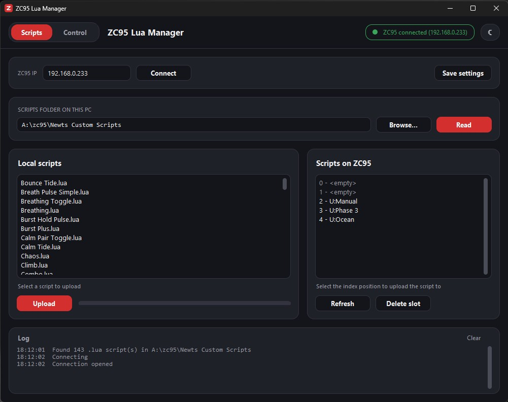
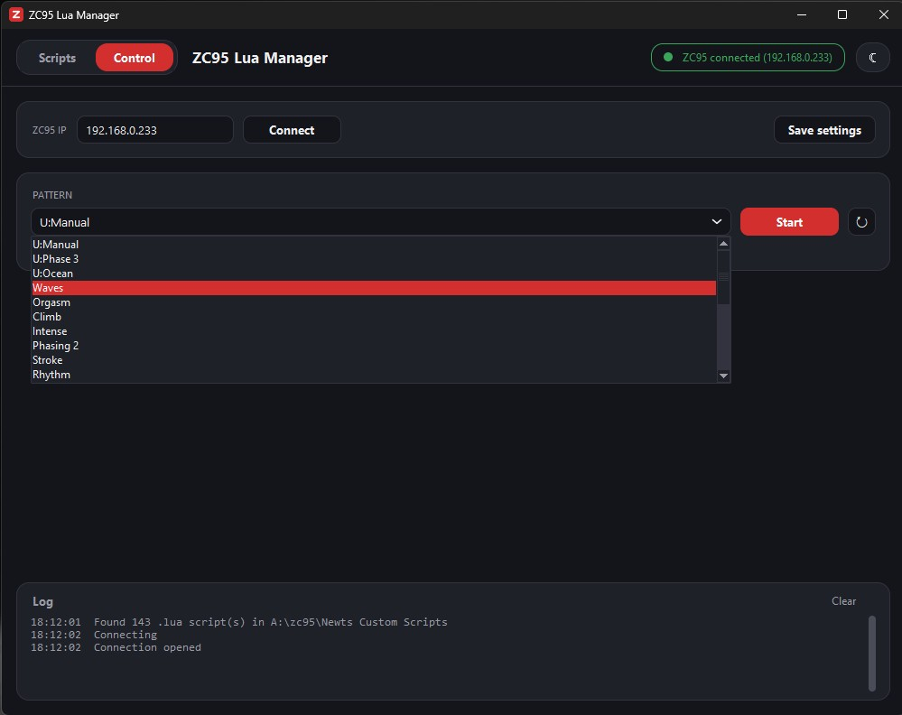
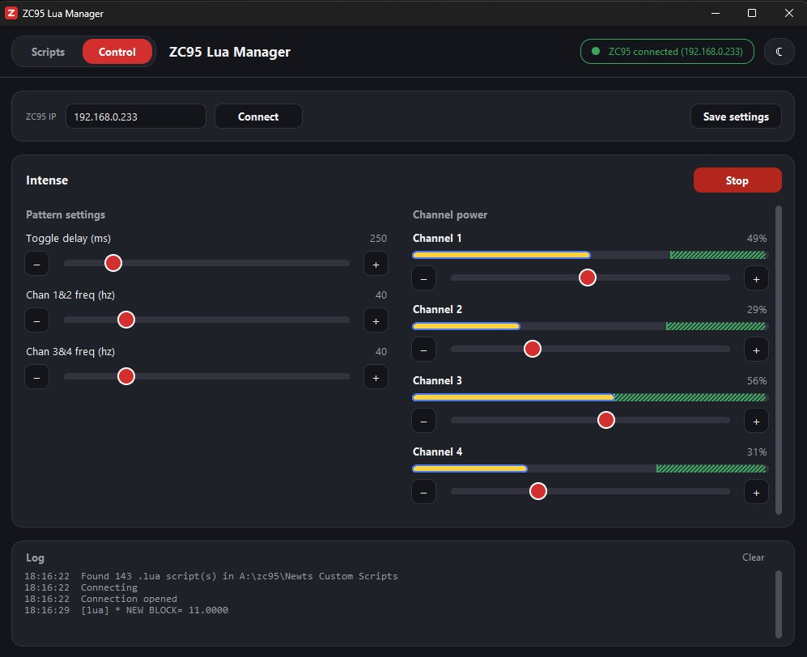

# ZC95 Lua Manager



ZC95 Lua Manager is a Windows desktop app for managing and controlling a
[ZC95](https://github.com/CrashOverride85/zc95) over WiFi. Instead of uploading Lua scripts from the command
line, you point the app at a folder of scripts on your PC, pick one, pick a slot on the box, and click
**Upload**.

The app has two views, chosen with the buttons at the top left:

- **Scripts**: lists the `.lua` scripts in a folder on your PC alongside the scripts already on the ZC95
  (slots 0-4). Select a local script and a slot to upload it, or delete a script from a slot. A progress bar
  shows the upload.
- **Control**: start any pattern on the ZC95 and drive it from your PC: change its menu settings, hold its
  soft button, and set each channel's power, with live bars showing the power and output the box is using.
  It works like the ZC95's browser remote (`webgui.py`), without needing a web server.

**Choosing a pattern**



**A pattern running**



It also has:

- A connection status indicator that checks the ZC95 every 5 seconds.
- A log pane showing connection messages, errors from the ZC95 and `print()` output from running Lua scripts.
- Light and dark themes, and saved settings (ZC95 IP address and scripts folder).

## Installation

### Option 1: download the app (no Python needed)

1. Go to [Releases](https://github.com/SedyDev23/zc95_app/releases) and download the latest
   `ZC95-Lua-Manager-....zip`.
2. Unzip it and run **`ZC95 Lua Manager.exe`**. The `lua` folder next to it has example scripts.

The exe isn't code-signed, so the first time Windows may show "Windows protected your PC". Click
**More info**, then **Run anyway**.

### Option 2: run from the source code

1. Install **Python 3.8+** from [python.org](https://www.python.org/downloads/windows/). Tick
   "Add python.exe to PATH" and keep "tcl/tk" selected.
2. Install the one extra package:

   ```
   cd remote_access
   py -m pip install -r requirements-manager.txt
   ```

3. Double-click `remote_access\ZC95 Lua Manager.bat`, or run `py zc95_lua_manager.py`.

See [remote_access/ZC95_LUA_MANAGER.md](remote_access/ZC95_LUA_MANAGER.md) for full instructions.

## Building the exe

**On your PC:** double-click `remote_access\build_exe.bat` (needs Python and an internet connection the
first time). It makes its own build environment in `.build-venv`, so nothing is installed into your main
Python, and produces `remote_access\dist\ZC95 Lua Manager.exe` with the example scripts in `dist\lua`.

**On GitHub, as a Release:** push a version tag and GitHub builds the exe and attaches the zip to a new
Release automatically:

```
git tag v1.0
git push origin v1.0
```

You can also run the build by hand from the repo's **Actions** tab ("Build Windows exe" > "Run workflow");
the zip then appears under that run's Artifacts. The workflow is `.github/workflows/build-exe.yml`.

## What's in here

| Path | |
|---|---|
| `remote_access/zc95_lua_manager.py` | The desktop app (Tkinter) |
| `remote_access/ZC95 Lua Manager.bat` | Launcher with no console window |
| `remote_access/ZC95_LUA_MANAGER.md` | How to install and use the app |
| `remote_access/build_exe.bat`, `build/make_icon.py`, `requirements-build.txt` | Build the standalone exe |
| `.github/workflows/build-exe.yml` | Builds the exe on GitHub and attaches it to a Release |
| `remote_access/lib/`, `lua_manage.py`, `lua_upload.py`, `pattern_list.py`, `pattern_gui.py`, `webgui.py`, `web_static/` | Remote-access code from the ZC95 project, which the app uses |
| `remote_access/lua/` | Example Lua scripts from the ZC95 project |
| `remote_access/LuaNotes.md` | The ZC95 project's Lua scripting reference |

## Credits

The ZC95 and its remote-access code (`lib/`, the command-line scripts, the web remote and the example Lua
scripts) are from the [ZC95 project](https://github.com/CrashOverride85/zc95). This repository adds the
Windows desktop app (`zc95_lua_manager.py` and its launcher and documentation).

## Licence

GNU General Public License v3.0, the same as the ZC95 project; see [LICENSE](LICENSE). The files copied from
the ZC95 project remain under that project's copyright.
